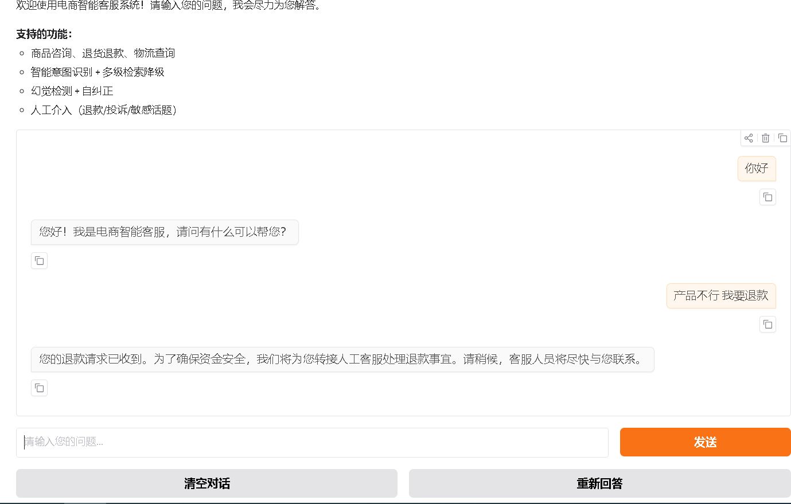
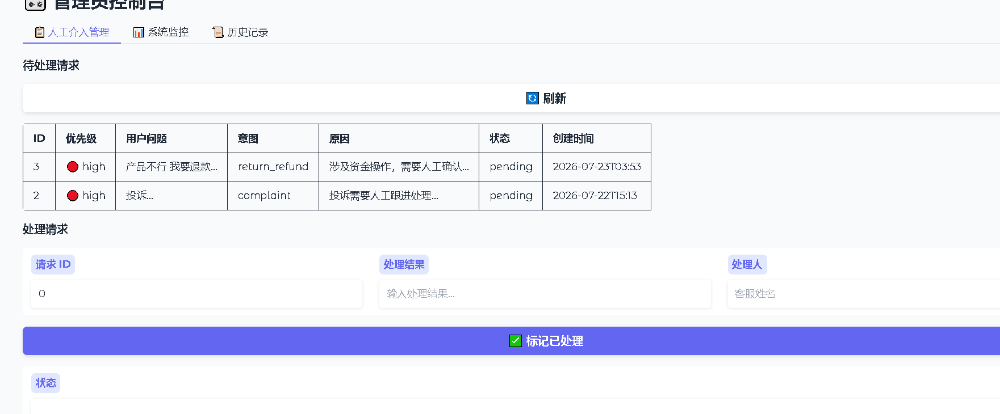
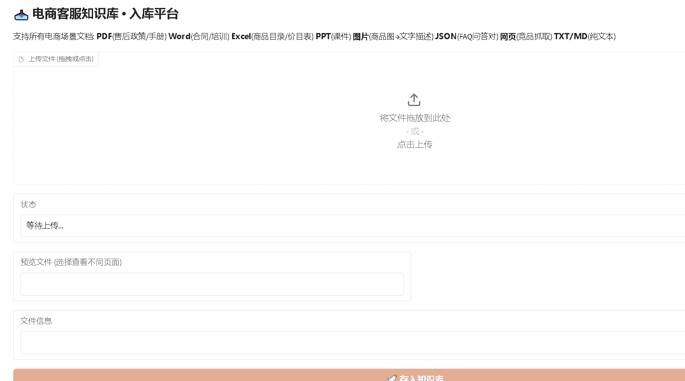
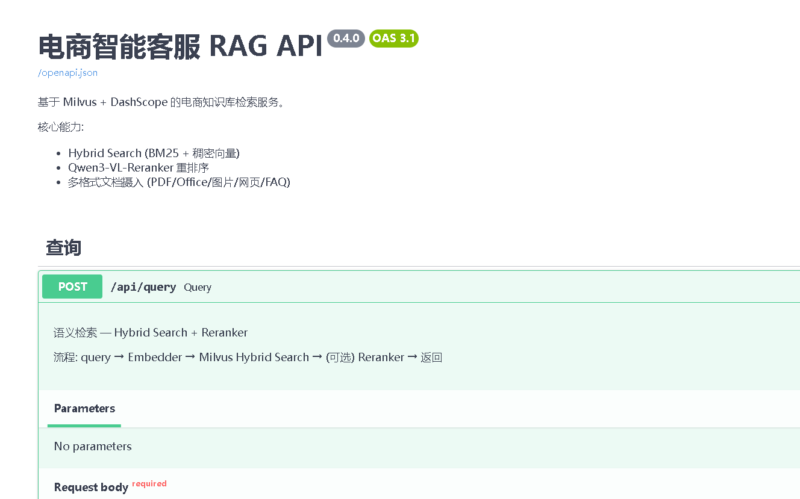
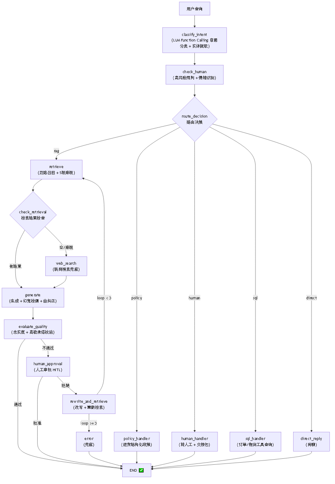

# 🤖 Agentic RAG 电商智能客服系统

<p align="center"><b>E-commerce Customer Service System</b></p>

> 基于 LangGraph 13 节点编排的 Agentic RAG 系统 — 双路召回、L0 至 L5 六级降级、幻觉检测自纠正、Human-in-the-Loop、三层记忆、业务工具调用

[](https://www.python.org/)
[](https://fastapi.tiangolo.com/)
[](https://www.trychroma.com/)
[](https://langchain-ai.github.io/langgraph/)
[](LICENSE)

---

## 📖 业务背景

本项目服务于**公司私域礼赠业务**：节假日档期公司面向客户与员工发放礼品，礼品外包装上的二维码是用户进入私域页面的主要入口，页面内承载礼品信息、物流查询、售后政策与客服入口。这一场景带来三个业务约束。

- **流量脉冲**：档期咨询量约为日常的 30 倍，客服团队按日常规模配置，峰值期排队加剧，临时增员成本高且新人更易在敏感问题上说错话。
- **问法口语化**：用户是被动收礼人，没有浏览商品页与购物车的经历，提问常无主语、不带订单号。
- **答错代价不对称**：食品类答错涉及食品安全，退款时效与价格承诺答错涉及赔付与客诉。

因此系统的目标不是"把平均准确率再抬高一点"，而是**让高频低价值的重复咨询自助闭环，同时把不确定的、高风险的问答识别出来交给人工**。设计重心落在检索链路与生成质量链路这两段。

---

## 📊 评测指标（49 条客服问答 · 6 意图 × 3 难度）

| 指标 | 数值 | 说明 |
|------|------|------|
| **Recall@5** | **0.755** | 检索召回率（Top-5 命中相关文档的比例） |
| **MRR** | **0.725** | 排序质量 |
| **NDCG@5** | **0.728** | 整体排序 |
| **Faithfulness** | **0.72** | 完整 RAG 生成忠实度 |
| 关键词覆盖率 | 0.976 | 命中关键词 |

> 一键复现：`python scripts/run_benchmark.py --with-generation`（报告存 `reports/benchmark_*.json`）
>
> **口径说明**：Recall@5 判定方式为「Top-5 中是否存在与标准答案 embedding 余弦相似度 ≥0.70 的文档」，属于**命中率（hit rate）口径**，不是标准 IR 中需要逐文档相关性标注的 recall。评测集为自建 49 条，定位是**回归验证**，不用于对外精度承诺。

---

## 📸 Demo

<p align="center">
  
  
</p>
<p align="center">
  
  
</p>

> 访问地址：聊天 `:7861` · 入库 `:7860` · 管理员 `:7862` · API 文档 `:8000/docs`

---

## ✨ 功能全景

### 🔍 检索系统（双路召回 + L0 至 L5 六级级联）

| 功能 | 说明 | 状态 |
|------|------|------|
| **Dense 检索** | Chroma 余弦检索 + 本地 `bge-small-zh-v1.5`（512 维），query 侧加中文 instruction、L2 归一化 | ✅ |
| **双路召回** | 原始问题 + 改写问题并行检索 → 合并去重 → 精排 | ✅ |
| **复杂查询分解** | 检测"和/对比/区别"→ 拆子问题并行检索汇总 | ✅ |
| Reranker 精排 | 本地 `bge-reranker-base`（sentence-transformers **CrossEncoder**），初始 20 候选 → 精排 Top-5 | ✅ |
| 查询改写 (L2) | LLM 改写模糊 query，最多 2 次 | ✅ |
| 查询扩展 (L3) | Multi-Query 多角度扩展 + HyDE 假设文档嵌入，并行检索 | ✅ |
| 联网搜索 (L4) | 智谱 GLM-4-Flash 优先，Tavily Search 备选 | ✅ |
| 诚实兜底 (L5) | "根据已有信息无法确认，建议咨询人工客服" | ✅ |
| 意图路由 | LLM Function Calling，6 类意图 + 工具/政策子路由 | ✅ |

> 📌 **关于向量库与检索方案**：当前实现是 **Chroma + 纯稠密检索 + 本地 BGE（Embedding + CrossEncoder 精排）**，全部本地推理，无外部 API 依赖。
> 早期版本用的是 **Milvus + BM25/Dense 混合检索（WeightedRanker 权重 0.3/0.7）+ 云端 qwen 系 Embedding/Reranker**；
> 后因调用成本、外部依赖与部署复杂度，迁移到 Chroma + 本地模型。Milvus 时期的 `milvus_store.py`、`synonyms.py` 与 `docker-compose-milvus.yml` 已于 2026-10 清理删除，当前代码中不再有相关残留。

### 🧠 生成质量（幻觉检测 + 高敏护栏）

| 功能 | 说明 | 状态 |
|------|------|------|
| 幻觉检测 | G-Eval 风格，**claims 级聚合**（不信 LLM 自报标量），逐条断言检查 | ✅ |
| 自纠正闭环 | 最多 2 轮：检测 → 提取缺失信息 → 改写重搜 → 重新生成 | ✅ |
| **高敏承诺护栏** | 价格/退款/政策承诺需忠实度 ≥0.85，不达标转人工核验 | ✅ |
| 忠实度评分 | 每个回答附带 faithfulness 分数 | ✅ |
| LLM 调用预算 | 单次请求最多 8 次 LLM 调用，防止延迟爆炸 | ✅ |

### 💼 业务工具（RAG + 工具 + 转人工）

| 功能 | 说明 | 状态 |
|------|------|------|
| **订单/物流查询** | 检测订单号/快递单号 → 查真实 MySQL（copilot 库 30万订单 + 24.6万轨迹），MySQL 不可达自动降级 mock | ✅ |
| **退货结构化政策** | 退货窗口/运费/时效/质量争议 子场景路由，零幻觉回答 | ✅ |
| **转人工交接包** | 摘要+实体+情绪+已尝试动作，客服拿包直接接手 | ✅ |
| **同窗口人工对话** | 转人工后客户消息进人工，客服回复主动推回（gr.Timer 轮询） | ✅ |

> 📌 订单/物流数据：copilot MySQL（本项目 `data/db/` 管理，只读账号 `agent_ro`）。
> 演示单号：`ORD000000001`（已签收，韵达 `YD000000638365`）/ 物流轨迹 `SF1234567890`。
> 建库/重建：`data/db/copilot_init.sql` + `seed_orders.py` + `seed_tracking.py`。配置见 `src/config.py` §订单数据库。

### 🧠 三层会话记忆

| 层 | 说明 | 状态 |
|------|------|------|
| 短期窗口 | 最近 6 轮原文保留 | ✅ |
| 滚动摘要 | 窗口外旧对话 LLM 压缩（实体感知） | ✅ |
| **实体 ledger** | 券/订单/金额 每轮抽取，"上次那个券"靠实体表解析 | ✅ |
| 指代消解护栏 | 分类为 chitchat 但含指代词 → 强制走 RAG | ✅ |

### 🎯 LangGraph 编排

| 功能 | 说明 | 状态 |
|------|------|------|
| 13 节点 StateGraph | **13 节点 / 8 条静态边 / 5 组条件边**（13 个分支目标） | ✅ |
| Agentic 回路 | evaluate → human_approval → rewrite → retrieve → generate (最多 3 轮) | ✅ |
| Human-in-the-Loop | LangGraph `interrupt_before` 真正中断，外部注入审批结果 | ✅ |
| 级联检索可视化 | retrieve 和 web_search 是独立图节点，流程可观测 | ✅ |
| **政策时效** | effective_from/to 生效窗口，检索自动过滤过期 + 写入后缓存失效 | ✅ |

### 🛡️ 安全防御（4 层 + PII）

| 层级 | 说明 | 状态 |
|------|------|------|
| 输入清洗 | 检测 Prompt 注入攻击，过滤恶意输入 | ✅ |
| **PII 脱敏** | 手机号/身份证/银行卡 7 类正则自动替换 | ✅ |
| 角色锚定 | System Prompt 加固，防止越狱 | ✅ |
| 文档过滤 | 入库前检查恶意内容 | ✅ |
| 输出护栏 | 防止系统提示词泄露 | ✅ |

### 🔐 鉴权 + 内容级权限隔离（模块33）

| 功能 | 说明 | 状态 |
|------|------|------|
| **JWT 鉴权** | `/api/auth/login` 签发（sub/role/access_level/exp），`get_current_user`/`require_admin` 依赖 | ✅ |
| **内容级权限隔离** | 层级 `access_level: public(0) < member(1) < vip(2)`，入库打标签、检索 `access_level <= 用户等级` 过滤 | ✅ |
| **缓存隔离** | 检索缓存 key 含 access_level，不同权限用户不串缓存 | ✅ |
| **全链路透传** | 降级 L0 至 L5 六级 / 查询扩展 / 双路召回 / 自纠正 / 工作流兜底 7 个调用点逐层透传，默认 public fail-safe | ✅ |
| **会话隔离** | 会话按 `{username}:{session_id}` 命名空间隔离 | ✅ |
| 管理面保护 | upload/stats/evaluate 需 admin；`/api/health` 公开探活 | ✅ |
| demo 用户 | admin/vip/member/normal 四档（.env 可覆盖） | ✅ |

### 📊 评估体系

| 指标 | 实现方式 | 状态 |
|------|----------|------|
| Recall@5 / Precision@5 | Embedding 余弦相似度 (阈值 0.7) | ✅ |
| MRR / NDCG@5 | Embedding 相似度排名 | ✅ |
| Faithfulness | LLM G-Eval 精确 / Embedding 快速 双模式 | ✅ |
| **幻觉率 / 纠正轮数** | 生成侧信号，完整 RAG 模式输出 | ✅ |
| Keyword Coverage | 字符串匹配 | ✅ |
| Latency Score | 延迟归一化 + P50/P95/P99 | ✅ |
| 完整 RAG 评估 | `with_generation=True` 走检索+生成全链路 | ✅ |
| **质量门禁** | `scripts/eval_gate.py` 阈值不达标 exit 1（发布前手动跑，依赖真实知识库与 API Key，未接入 CI） | ✅ |

### 🔧 工程基础设施

| 功能 | 说明 | 状态 |
|------|------|------|
| LLMClient 统一调用 | 同步 httpx.Client + 异步 httpx.AsyncClient，自动重试+降级 | ✅ |
| **熔断器** | 三态状态机 CLOSED→OPEN→HALF_OPEN，LLM/Embedding 独立阈值 | ✅ |
| 三层缓存 | Query 缓存 + Embedding 缓存 + LLM 响应缓存（Redis 可序列化） | ✅ |
| 结构化日志 | JSON 行文件 + ANSI 控制台双输出 | ✅ |
| 成本监控 | 每日统计 (请求量/费用/模型分布)、P99 延迟 | ✅ |
| 生产级错误处理 | 重试策略 + 降级 + 兜底 | ✅ |
| 线程安全单例 | @singleton_factory 双重检查锁定 | ✅ |
| 速率限制 | Embedding 编码并发控制 | ✅ |

### 🌐 流式与多轮对话

| 功能 | 说明 | 状态 |
|------|------|------|
| SSE 流式输出 | asyncio.to_thread 非阻塞检索 + 逐 token 返回 | ✅ |
| 多轮对话 | SQLite 会话管理 + 三层记忆 | ✅ |
| 智能重检索 | 多轮对话时判断追问/切换/澄清，避免重复检索 | ✅ |
| 情绪识别 | 四级情绪分级，愤怒/极端直接转人工 | ✅ |
| 人工介入 | 4 类场景 + 优先级 + 交接包 + 同窗口人工对话 | ✅ |

### 📥 数据摄入

| 功能 | 说明 | 状态 |
|------|------|------|
| **PDF 文本快路径** | 纯文本页 fitz 零成本提取，仅扫描页走**本地 RapidOCR**，含图页即使有文本也走 OCR，逐页分类合并 | ✅ |
| Office 文档 | Word(.docx) / Excel(.xlsx) / PPT(.pptx) | ✅ |
| 图片解析 | SiliconFlow VLM 生成文字描述，支持商品图片 | ✅ |
| FAQ JSON | 结构化问答对导入 | ✅ |
| 网页抓取 | URL 内容提取 | ✅ |
| 纯文本 | TXT / Markdown | ✅ |
| **入库元数据** | ingested_at / content_hash / embedding模型 / 政策时效 / 切分策略检测 | ✅ |
| 文件防御 | 上传预检 (类型/大小/格式) + 质量检查 | ✅ |

### ✂️ 智能分块

| 策略 | 适用场景 | 状态 |
|------|----------|------|
| Markdown 分块 | 标题层级感知切分 | ✅ |
| FAQ 分块 | Q&A 问答对识别（含内容级自动检测） | ✅ |
| 语义分块 | Embedding 相似度边界切分 | ✅ |
| 递归分块 | 固定长度 + 重叠，兜底策略 | ✅ |
| 分块路由 | 按文档类型 + 内容形态自动选择 | ✅ |
| **策略变更检测** | 库中已有 target_size 与新批次不一致 → 告警全量重建 | ✅ |

### 🗂️ 管理面板 (3 套 UI)

| 面板 | 端口 | 功能 | 状态 |
|------|------|------|------|
| 知识库入库 | 7860 | **批量上传** + 预览小窗口 + 入库状态 + 自动去重 | ✅ |
| 用户聊天 | 7861 | 流式对话 + 意图显示 + 来源追踪 + HITL 同窗口人工对话 | ✅ |
| 管理员 | 7862 | HITL 工单 + **人工对话实时** + 系统监控 + 历史记录 | ✅ |

### 🚢 部署

| 功能 | 说明 | 状态 |
|------|------|------|
| Docker Compose | 5 服务编排 (api/gradio/chat-ui/admin-ui/redis) | ✅ |
| **时区** | Asia/Shanghai，管理员界面时间对齐北京时间 | ✅ |
| CI/CD | GitHub Actions lint+test+typecheck+security | ✅ |
| 健康检查 | 所有服务健康探针 + /api/health 端点 | ✅ |
| 配置中心 | pydantic-settings，.env 文件注入 | ✅ |

---

## 🏗️ 系统架构

<p align="center">
  
</p>

> 说明：GitHub 原生 Mermaid 渲染该图报布局错误，已用 mermaid-cli 渲染为 PNG 图片。
> 可编辑的 Mermaid 源图见 [`docs/architecture.mmd`](docs/architecture.mmd)。

### 检索降级流程（L0 至 L5 六级）

```
Level 0: 复杂查询分解（检测"和/对比/区别" → 拆子问题并行检索汇总）
Level 1: 双路召回稠密检索（原始问题 + 改写问题 → Chroma 余弦 + 本地 bge → 合并去重 → Reranker 精排）
Level 2: LLM 改写查询 → 重新检索（最多 2 次）
Level 3: Multi-Query + HyDE → 并行检索
Level 4: 联网搜索（智谱 / Tavily）
Level 5: 诚实兜底
```

---

## 📐 架构决策记录 (ADR)

关键设计决策的背景/取舍/后果记录在 [docs/ADR.md](docs/ADR.md)（10 个 ADR：检索架构/双路召回/幻觉检测/三层记忆/政策时效/PDF解析/高敏护栏/模型选型/内容级权限隔离/向量库迁移）。

> ⚠️ ADR-001（混合检索）与 ADR-008（Embedding 模型）记录的是 **Milvus 时期的选型决策**，文中已标注「已被 Chroma + 本地 BGE 方案取代」；**ADR-010 记录了这次迁移本身的完整取舍**，请结合当前实现阅读。

---

## 🚀 快速开始

### 环境要求

- Python 3.12+
- Docker & Docker Compose
- 8GB+ RAM
- **本地模型文件**（不联网下载，需随仓库/镜像提供）：
  - `local_models/models/BAAI--bge-small-zh-v1.5/snapshots/master` — Embedding
  - `local_models/models/BAAI--bge-reranker-base/snapshots/master` — Reranker（CrossEncoder）
- API Key：
  - [DeepSeek](https://platform.deepseek.com/) — 主 LLM 对话（**必填**）
  - [智谱 AI](https://open.bigmodel.cn/) — 联网搜索（可选）
  - [SiliconFlow](https://siliconflow.cn/) — 图片理解 VLM（可选，仅图片入库需要）
  - [Tavily](https://tavily.com/) — 联网搜索备选（可选）
  - *Embedding / Reranker / OCR 全部本地推理，无需 API Key*

### 1. 克隆 & 配置

```bash
git clone https://github.com/robben617/gift-rag-customer-service.git
cd gift-rag-customer-service
cp .env.example .env
# 编辑 .env 填入 API Key，并设置本地模型路径：
#   EMBEDDING_MODEL_PATH=./local_models/models/BAAI--bge-small-zh-v1.5/snapshots/master
#   RERANKER_MODEL_PATH=./local_models/models/BAAI--bge-reranker-base/snapshots/master
#   JWT_SECRET=<≥32 字节随机串>
```

### 2. 启动

```bash
docker compose -f docker-compose-rag.yml up -d --build   # RAG 服务（含 Redis）
```

> 📌 **容器内需要挂载本地模型**：Dockerfile 只复制 `src/`，不包含模型权重。
> 部署时请确保 compose 中已挂载 `./local_models:/app/local_models`，并把 `EMBEDDING_MODEL_PATH` / `RERANKER_MODEL_PATH` 指向容器内路径。
>
> 📌 向量库为 **Chroma 本地持久化**，**不需要启动任何外部向量库服务**。compose 使用本地 `rag-net` 桥接网络，可直接 `up -d`。

### 3. 访问

| 服务 | 地址 | 说明 |
|------|------|------|
| API 文档 | http://localhost:8000/docs | Swagger UI |
| 知识库入库 | http://localhost:7860 | 文档批量上传解析 |
| 用户聊天 | http://localhost:7861 | 客服对话 |
| 管理员控制台 | http://localhost:7862 | 人工介入管理 |

### 4. 鉴权（模块33 起 API 需登录）

```bash
# 登录拿 token（用户面: 任意用户；管理面: admin）
TOKEN=$(curl -s -X POST http://localhost:8000/api/auth/login \
  -H "Content-Type: application/json" \
  -d '{"username":"member","password":"member123"}' | python3 -c "import sys,json;print(json.load(sys.stdin)['access_token'])")
# 后续请求带 Authorization: Bearer $TOKEN
```

### 5. 评测

```bash
# 检索指标
python scripts/run_benchmark.py
# 完整 RAG（检索+生成）
python scripts/run_benchmark.py --with-generation
# 质量门禁（不达标 exit 1）
python scripts/eval_gate.py
```

---

## 📁 项目结构

```
src/
├── ingestion/       # 多格式摄入 (PDF文本快路径/RapidOCR/Word/Excel/PPT/Image/JSON/web/TXT)
├── chunking/        # 4 种分块策略 + 内容形态路由 + 策略变更检测
├── embedding/       # Embedder(本地bge) + Chroma store + Retriever + 双路召回 + L0至L5六级降级
├── routing/         # LLM Function Calling 意图分类 + 指代护栏 + 工具路由
├── retrieval/       # 本地 CrossEncoder Reranker 重排序
├── generation/      # claims聚合幻觉检测 + 自纠正闭环 + 高敏护栏
├── conversation/    # SSE 流式 + 会话管理 + 三层记忆 + 情绪识别 + 人工介入
├── engineering/     # 熔断器/缓存/监控/日志/错误处理/安全/PII/统一LLMClient
├── evaluation/      # 评估器 + 9 指标 + 金标准测试
├── graph/           # LangGraph 13 节点 StateGraph + 条件边 + HITL
├── orders/          # 订单/物流查询工具 (MySQL + mock 降级)
├── business/        # 退货结构化政策工具
├── api/             # FastAPI + 路由 (auth/query/chat/stream/upload/evaluate/stats)
├── admin/           # Gradio UI ×3 (入库/聊天/管理员)
└── config.py        # pydantic-settings 配置中心

local_models/        # 本地 BGE 模型权重（Embedding + Reranker）
data/chroma/         # Chroma 持久化目录
```

---

## 🐳 Docker 服务

| 服务 | 端口 | 说明 |
|------|------|------|
| rag-redis | 6379 | 三层缓存 |
| rag-api | 8000 | FastAPI 主服务 |
| rag-gradio | 7860 | 知识库入库平台 |
| rag-chat-ui | 7861 | 用户聊天界面 |
| rag-admin-ui | 7862 | 管理员控制台 |

---

## ⚙️ 配置

```bash
# LLM
DEFAULT_MODEL=deepseek-chat
FALLBACK_MODEL=qwen-plus

# Embedding（本地 BAAI/bge-small-zh-v1.5）
EMBEDDING_MODEL=bge-small-zh-v1.5
EMBEDDING_DIM=512
EMBEDDING_MODEL_PATH=./local_models/models/BAAI--bge-small-zh-v1.5/snapshots/master
EMBEDDING_BATCH_SIZE=64

# Reranker（本地 BAAI/bge-reranker-base，CrossEncoder）
RERANKER_MODEL=bge-reranker-base
RERANKER_MODEL_PATH=./local_models/models/BAAI--bge-reranker-base/snapshots/master
RERANKER_ENABLED=true
RERANKER_TOP_N=5

# 向量库（Chroma）
CHROMA_PERSIST_DIR=./data/chroma
CHROMA_COLLECTION=ecommerce_knowledge

# 文档解析 / 图片理解
OCR_MODEL=rapidocr                       # 本地 RapidOCR
VISION_MODEL=Qwen/Qwen3-VL-8B-Instruct   # SiliconFlow 图片理解
SILICONFLOW_API_KEY=sk-xxxxxxxx

# 联网搜索（智谱 / Tavily）
ZHIPU_API_KEY=xxxxxxxx
ZHIPU_WEB_SEARCH_ENABLED=true
TAVILY_API_KEY=xxxxxxxx                  # 可选，备选搜索引擎

# 检索（阈值是 bge 余弦量纲，不是内积量纲）
RETRIEVAL_TOP_K=5
RETRIEVAL_DENSE_TOP_K=20
RETRIEVAL_SIMILARITY_THRESHOLD=0.4

# 缓存
QUERY_CACHE_TTL=3600

# 幻觉
MAX_CORRECTION_ROUNDS=2
FAITHFULNESS_THRESHOLD=0.8

# 高敏承诺（价格/退款/政策）
HIGH_STAKE_FAITHFULNESS=0.85

# 鉴权
JWT_SECRET=<≥32 字节随机串>
```

---

## 🗺️ Roadmap

- [x] Dense 稠密检索（Chroma 余弦 + 本地 bge-small-zh）
- [x] 双路召回 + 合并去重
- [x] 复杂查询主动分解
- [x] L0 至 L5 六级降级检索 + 本地 CrossEncoder 精排
- [x] 6 类意图路由 + 指代护栏
- [x] claims 聚合幻觉检测 + 自纠正闭环
- [x] 高敏承诺护栏
- [x] 订单/物流工具 + 退货结构化政策
- [x] 三层会话记忆 + 情绪识别 + 转人工交接包
- [x] Human-in-the-Loop + 同窗口人工对话
- [x] PDF 文本快路径 + 政策时效 + 缓存失效
- [x] 4 种分块策略 + 内容形态路由 + 策略变更检测
- [x] 评估体系 (9 指标 + 金标准测试 + 幻觉率 + 质量门禁脚本)
- [x] 4 层安全防御 + PII 脱敏 + 熔断器
- [x] JWT 鉴权 + 内容级权限隔离（RBAC + 检索过滤 + 缓存/会话隔离）
- [x] 向量库从 Milvus 迁移到 Chroma（去掉外部依赖，Embedding/Reranker 全本地）
- [x] Docker Compose + CI/CD + 时区修复
- [ ] RAGAS 评估集成
- [ ] Graph RAG (知识图谱)
- [ ] 多模态检索（当前 bge 是纯文本模型，图片需先经 VLM 转描述）
- [ ] 语义缓存 (GPTCache)
- [ ] Kubernetes 部署

---

## 🤝 技术选型

| 技术 | 选择原因 |
|------|----------|
| **Chroma** | 本地持久化、零外部服务、轻量；数据量不大时纯稠密检索足够（替代 Milvus） |
| **bge-small-zh-v1.5** | 中文效果好、512 维省存储、本地推理无 API 成本；query 侧加官方中文 instruction |
| **bge-reranker-base** | 本地 CrossEncoder，query-doc 逐对打分比双塔准，且不依赖外部 API |
| **LangGraph** | 图结构可视化、TypedDict State 管理、HITL 原生支持 |
| **DeepSeek** | 中文能力强、Function Calling、成本低 |
| **FastAPI** | async 原生、自动 Swagger、高性能 |
| **Gradio** | Python 原生 UI，快速构建和管理 |

---

## 📄 License

MIT — 详见 [LICENSE](LICENSE)
